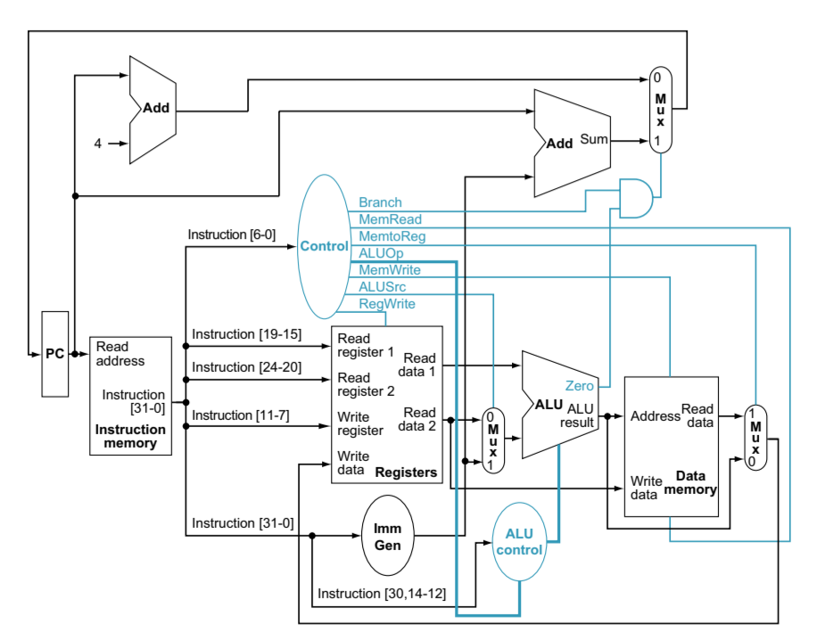
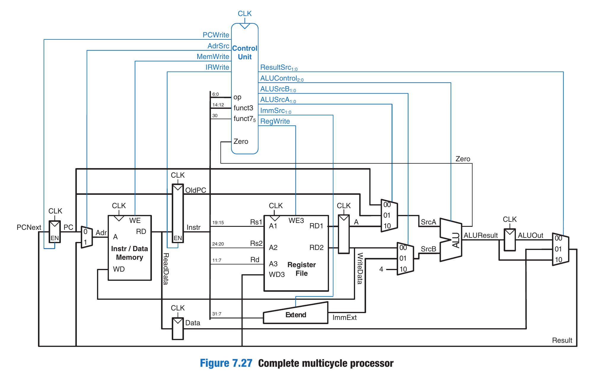

# RISC-V HDL Implementations

Educational RISC-V processor implementations in Verilog and SystemVerilog. The
repository currently contains single-cycle, multi-cycle, and five-stage
pipelined CPU designs.

## Implementations

| Design | HDL | Status | Main features |
|---|---|---|---|
| [Single cycle](./single_cycle) | Verilog | Complete | One instruction per clock cycle |
| [Multi cycle](./multi_cycle) | SystemVerilog | Complete | FSM-controlled instruction execution |
| [Five-stage pipeline](./pipeline) | SystemVerilog | Complete | Forwarding, stalls, and control-flow flushing |

## Single-Cycle Processor

Based on *Computer Organization and Design: RISC-V Edition* by David Patterson
and John Hennessy.

Supported instructions:

- Register ALU: `ADD`, `SUB`, `AND`, `OR`
- Memory: `LW`, `SW`
- Branch: `BEQ`



The `single_cycle/tb/` directory contains testbenches for the complete processor
and its individual datapath components.

## Multi-Cycle Processor

Based on *Digital Design and Computer Architecture* by David Money Harris and
Sarah L. Harris.

Supported instructions:

- Register ALU: `ADD`, `SUB`, `AND`, `OR`
- Memory: `LW`, `SW`
- Branch: `BEQ`

The controller uses nine states for instruction fetch, decode, execution,
memory access, write-back, and branch handling.



Run the self-checking integration test with Verilator:

```bash
verilator --binary --timing \
  --top-module tb_riscv_mc \
  -f multi_cycle/files.txt \
  --Mdir /tmp/riscv_mc_obj

/tmp/riscv_mc_obj/Vtb_riscv_mc
```

## Five-Stage Pipelined Processor

The pipeline implements the standard five execution stages:

1. **IF** — instruction fetch and `PC + 4`
2. **ID** — decode, register reads, and immediate generation
3. **EX** — ALU execution and branch/jump resolution
4. **MEM** — data-memory access
5. **WB** — register-file write-back

Pipeline state is carried by dedicated `IF/ID`, `ID/EX`, `EX/MEM`, and
`MEM/WB` register sets.

### Supported instructions

- Register ALU: `ADD`, `SUB`, `AND`, `OR`
- Immediate ALU: `ADDI`, `SLTI`, `SLTIU`, `XORI`, `ORI`, `ANDI`
- Immediate shifts: `SLLI`, `SRLI`, `SRAI`
- Memory: `LW`, `SW`
- Control flow: `BEQ`, `JAL`, `JALR`

### Hazard handling

- EX/MEM and MEM/WB operand forwarding
- Forwarding for ALU, branch, and store-data dependencies
- One-cycle stalls for load-use dependencies
- IF/ID and ID/EX flushing after taken branches and jumps
- WB-to-ID bypass independent of register-file edge timing
- Hardwired `x0` register

### Test

The self-checking integration test covers instruction execution, forwarding,
load-use stalls, taken and untaken branches, wrong-path flushing, jumps,
memory access, sign extension, and `x0` behavior.

```bash
verilator --binary --timing \
  --top-module tb_riscv_pipeline \
  -f pipeline/files.txt \
  --Mdir /tmp/riscv_pipeline_obj

/tmp/riscv_pipeline_obj/Vtb_riscv_pipeline
```

## Repository Layout

```text
.
├── single_cycle/   # Verilog single-cycle CPU and component tests
├── multi_cycle/    # SystemVerilog multi-cycle CPU and integration test
├── pipeline/       # SystemVerilog five-stage CPU and integration test
└── images/         # Datapath diagrams
```

## Requirements

- [Verilator](https://verilator.org/) with SystemVerilog and timing support
- A C++ compiler supported by Verilator
